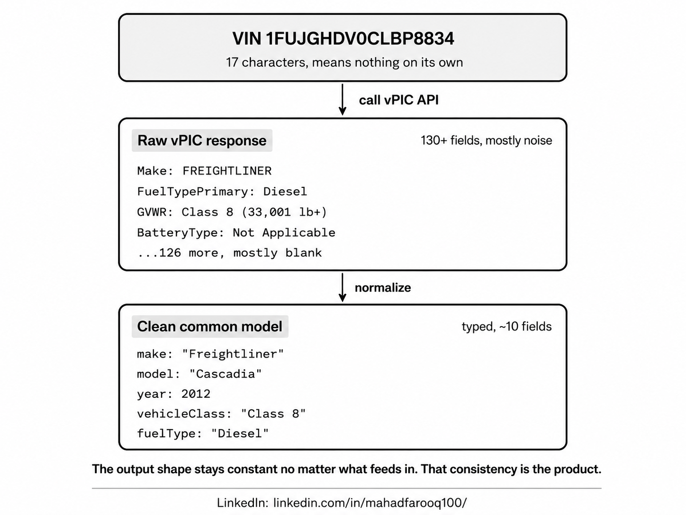

# VIN Decoder

[](https://github.com/MahadFarooq07/vin-decoder/actions/workflows/ci.yml)

Decode a VIN against the free NHTSA **vPIC** API and watch ~150 noisy, loosely-typed raw fields collapse into one clean, strongly-typed `Vehicle` "common model."

This mirrors how a telematics API company builds data enrichments: ingest a messy external source and reshape it into a single, consistent, typed contract its consumers can rely on. **The normalization layer is the point** — everything else is plumbing.


## How it works

A VIN goes in. We call the vPIC API, get back the raw mess, and run it through a normalizer that keeps the fields worth keeping, renames them, strips the junk, and coerces types. What comes out is a clean common model — the same shape every time, no matter what the raw data looks like.



## What is custom here?

The repository was initialized with Create Next App for framework configuration, then built into a purpose-specific portfolio application. The VIN validation rules, vPIC client, batch orchestration, typed common model, normalization rules, raw-versus-clean UI, and tests are original project work. The commit history keeps the small starter commit separate from the application implementation, making that progression inspectable.

This is not a tutorial clone or classroom exercise. Its central design problem is deciding how to turn an unstable external data shape into a small contract that downstream code can safely consume.

## The common model (the contract)

Every consumer codes against this typed shape, never against raw vPIC:

```ts
interface Vehicle {
  vin: string;
  make: string | null;
  model: string | null;
  year: number | null;
  vehicleType: string | null;       // from VehicleType
  bodyClass: string | null;         // from BodyClass, e.g. "Truck-Tractor"
  gvwrClass: string | null;         // parsed from GVWR, e.g. "Class 8"
  gvwrRange: string | null;         // the raw GVWR range text
  fuelTypePrimary: string | null;
  fuelTypeSecondary: string | null;
  driveType: string | null;
  engineCylinders: number | null;
  displacementL: number | null;
  manufacturer: string | null;      // from Manufacturer
  plantCountry: string | null;
  doors: number | null;
  errorCode: string | null;         // vPIC ErrorCode — data-quality signal
  errorText: string | null;         // vPIC ErrorText
}
```

The single pure function [`normalize(raw, vin)`](lib/normalize.ts) owns every rule:

- **Empties → `null`.** `""`, `"Not Applicable"`, and whitespace-only values collapse to `null`. `"0"` is deliberately kept — vPIC uses ErrorCode `"0"` to mean a clean decode.
- **Typed coercion.** `ModelYear`, `Doors`, `EngineCylinders` → numbers; `DisplacementL` → float. Absent/non-numeric → `null`, never `NaN`.
- **GVWR parsing.** `"Class 8: 33,001 lb and above (…)"` splits into `gvwrClass` (`"Class 8"`) plus the full original `gvwrRange` text.
- **Quality preserved.** `errorCode` / `errorText` are always carried through so consumers can judge data quality themselves.

> **Note on field names:** vPIC's flat `DecodeVinValues` response uses `Manufacturer` (not `ManufacturerName`). Verified against a live response; `normalize` falls back to `ManufacturerName` just in case.

## Architecture

```text
Browser input
    │
    ├─ one VIN ─────► GET /api/decode
    └─ many VINs ───► POST /api/decode/batch
                            │
                     validate + fetch vPIC
                            │
                     normalize(raw, vin)
                            │
             typed Vehicle + quality signals + raw evidence
```

The code follows a small functional-core / imperative-shell design:

- `lib/normalize.ts` and `lib/validateVin.ts` are pure, deterministic domain functions.
- `lib/vpic.ts` owns external I/O and translates transport failures into the typed `VpicError` class.
- `lib/decode.ts` is the single assembly point for response shapes and field counts.
- Route handlers translate HTTP requests into domain calls; React components only manage interaction and presentation.
- Shared limits and parsing live in `lib/vinInput.ts`, so the client, server, and tests cannot drift.

Object orientation is used where object identity and polymorphic error handling add value (`VpicError extends Error`). Stateless normalization and validation remain pure functions because forced class hierarchies would add state and ceremony without improving this domain.

## Run locally

Requires Node.js 22 or later (the tests use Node's native TypeScript stripping).

```bash
npm ci
npm run dev      # http://localhost:3000
npm run lint     # Next.js/React/TypeScript lint rules
npm run typecheck
npm test         # all unit tests
npm run build    # production build
```

No API key, no registration, no rate limit — vPIC is free and keyless.

## Deploy to Vercel

Zero config. Push to a Git repo and import it on Vercel, or:

```bash
npx vercel
```

There are no environment variables to set.

## API

| Method | Route                | Body / Query             | Returns |
| ------ | -------------------- | ------------------------ | ------- |
| `GET`  | `/api/decode`        | `?vin=XXXXXXXXXXXXXXXXX` | `{ vin, vehicle, raw, rawFieldCount, cleanFieldCount }` |
| `POST` | `/api/decode/batch`  | `{ "vins": string[] }`   | `{ results: DecodeResult[] }` |

- Invalid VINs return **400** with a readable JSON error (`{ error }`).
- vPIC / network failures return **502** with a readable message.
- In a batch, invalid VINs become inline error entries rather than failing the whole request.
- A batch accepts at most **25 VIN entries**; the UI removes duplicates before sending them, and client and server share the same limit.

## Testing and quality checks

The test suite uses Node's built-in test runner and TypeScript type stripping, keeping the project free of test-framework dependencies. It covers:

- normalization of empty sentinels, strings, numeric values, GVWR, manufacturers, and error codes;
- VIN trimming, casing, length, forbidden letters, and invalid characters;
- free-form batch input parsing, deduplication, and the public batch limit;
- decode-response assembly, raw/clean counts, and success/failure narrowing.

Every push and pull request runs linting, type-checking, unit tests, and a production build through [`.github/workflows/ci.yml`](.github/workflows/ci.yml).

## Example VINs

The demo ships three VINs, each verified to decode against the live API:

| Type          | VIN                 | Decodes to              |
| ------------- | ------------------- | ----------------------- |
| Heavy truck   | `1FUJGLDR5CLBP8834` | Freightliner Cascadia (Class 8) |
| Pickup        | `1FTFW1ET5DFC10312` | Ford F-150              |
| Passenger car | `1HGCM82633A004352` | Honda Accord            |

## Project structure

```
lib/
  vpic.ts            fetch wrapper for vPIC (single + batch) + RawVpicResult type
  normalize.ts       the Vehicle contract + the normalize() function (the centerpiece)
  validateVin.ts     17-char VIN validation (excludes I, O, Q)
  vinInput.ts        shared free-form parsing and batch limit
  decode.ts          shared decode types + orchestration (one source of truth)
  *.test.ts          unit tests (Node's built-in runner — no extra deps)
app/
  api/decode/route.ts        GET  single decode
  api/decode/batch/route.ts  POST batch decode
  components/                 UI (decoder, vehicle card, raw-vs-clean, batch table)
  page.tsx                   demo page
public/
  vindecoder.png             the how-it-works pipeline diagram
.github/workflows/ci.yml     automated repository quality gate
```

## Repository review

| Question | Evidence |
| --- | --- |
| Is it easy to navigate? | The application has a skip link, sticky section navigation, semantic landmarks, and keyboard-operable batch selection. The source is separated into routing/UI (`app`) and domain/integration code (`lib`). |
| Does it follow clean-code principles? | Strict TypeScript, descriptive names, pure single-purpose functions, shared response assembly, and one shared batch-input policy avoid duplication and magic counts. |
| Is it original work? | Yes. The custom VIN pipeline and UI are isolated from the initial Create Next App commit and documented above. |
| Was boilerplate substantially extended? | Yes. The starter supplied framework wiring; the domain model, API integration, routes, user experience, and tests were built for this sample. |
| Is it documented? | This README explains the problem, contract, architecture, setup, API, test strategy, and design decisions. Public functions and non-obvious rules also carry focused code comments. |
| Is there evidence of testing? | Test files sit beside the domain modules, `npm test` runs them, and GitHub Actions enforces the full quality gate. |
| Is object orientation used appropriately? | A custom error class is used at the I/O boundary; the stateless domain is intentionally modeled with functions and typed interfaces. |
| Is `.gitignore` appropriate? | Dependencies, Next.js output, coverage, local environment files, logs, OS files, and local tool permissions are excluded while source and CI configuration remain tracked. |

## Stack

Next.js (App Router) · React · TypeScript (strict, no `any`) · Tailwind CSS · Node test runner · GitHub Actions.

---

Data source: [U.S. NHTSA vPIC API](https://vpic.nhtsa.dot.gov/api/). This is a portfolio demo.

Created by [Mahad Farooq](https://www.linkedin.com/in/mahadfarooq100/).
